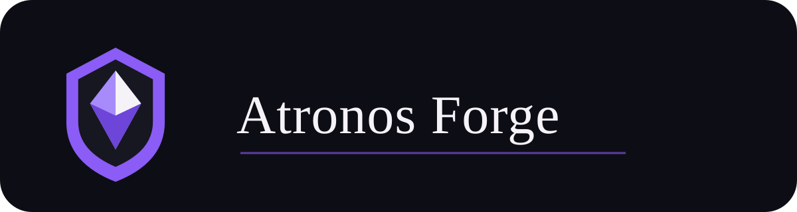

  

<h2 align="center">Sobre mim</h2>

  Sou desenvolvedor full-stack e gosto de criar aplicações úteis, bem estruturadas e fáceis de manter.
  Trabalho com Angular, TypeScript, Node.js, C#/.NET e PostgreSQL, além de APIs, testes e integrações.
  O Atronos Forge ampliou minha prática em infraestrutura, CI/CD e segurança: ambientes locais com Docker e Supabase,
  API em servidor Linux, Cloudflare Tunnel, GitHub Actions e autorização server-side.
  Uso ferramentas de IA como apoio à investigação e documentação, com revisão e testes antes de aceitar resultados.

<h2 align="center">Tech Stack</h2>

<h3 align="center">Front end</h3>

<h3 align="center">Back end e dados</h3>

Também trabalho com Fastify, Supabase Auth e APIs em TypeScript.

<h3 align="center">Ferramentas e infraestrutura</h3>

<h2 align="center">Projetos em destaque</h2>

  <strong>Atronos Forge</strong> é uma plataforma full-stack para D&D em desenvolvimento ativo:
  Hub público, Player mobile-first e offline-first e Dungeon Master para preparação e sessão.
  Aplicações independentes, API compartilhada e componentes versionados em <code>@atronos-forge/ui</code>.
  Angular, Fastify, Supabase/PostgreSQL e interfaces em pt-BR, en e es;
  o DM e sua integração cloud com o Player continuam em desenvolvimento.

<a href="https://atronos-forge.com">Conhecer a plataforma</a> · <a href="https://player.atronos-forge.com/">Abrir o Player</a>

<h2 align="center">Informações</h2>

  
  

<h2 align="center">Redes sociais, contatos e portfólio</h2>

  
  

Meu <strong>portfólio pessoal</strong> reúne projetos e experiência profissional em uma aplicação Angular com TypeScript, Tailwind CSS, Angular Material e testes com Jest.

